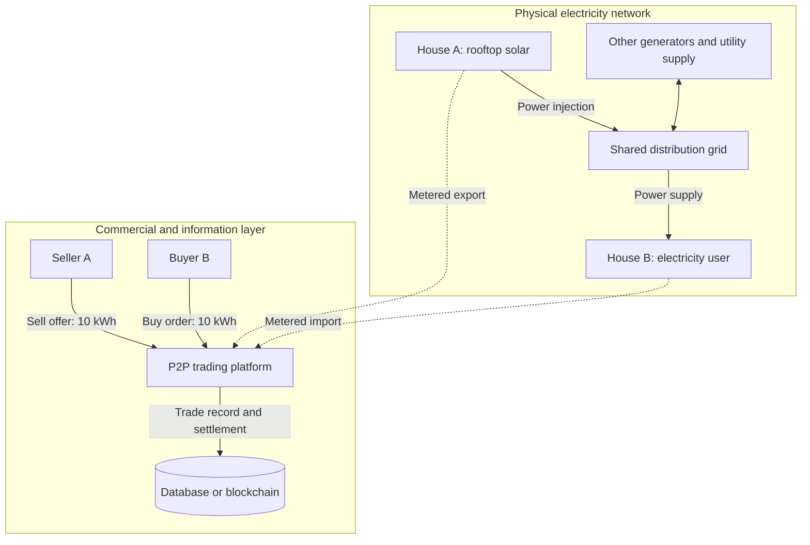
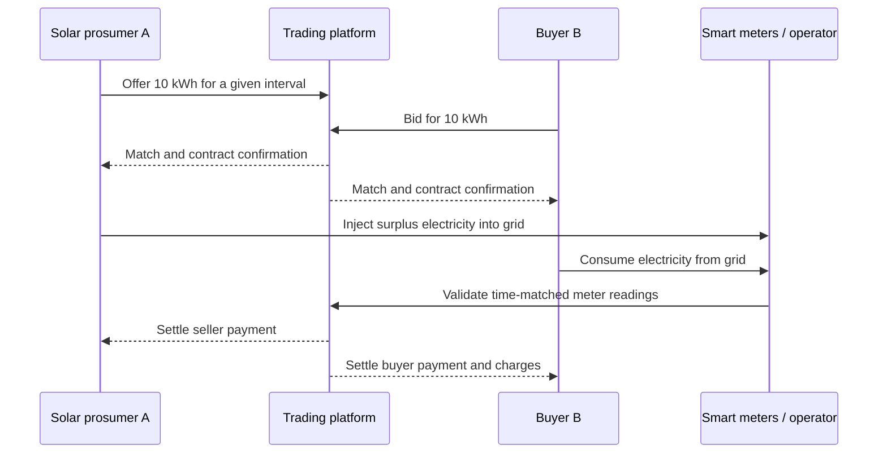
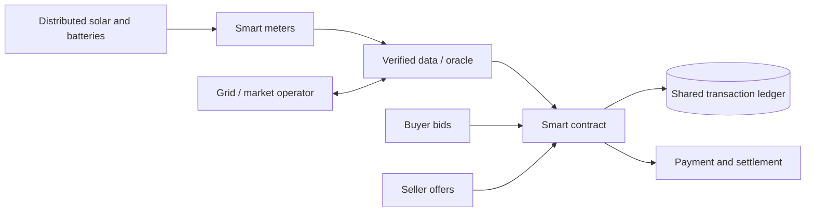
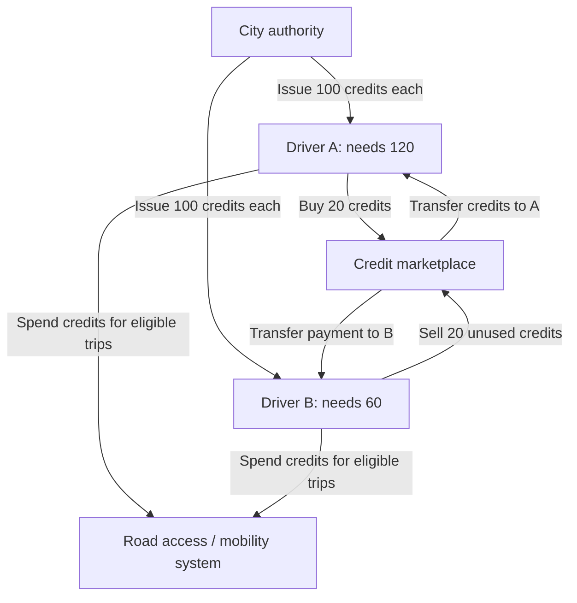
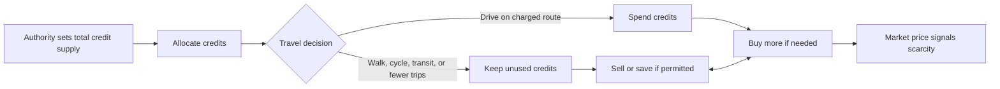
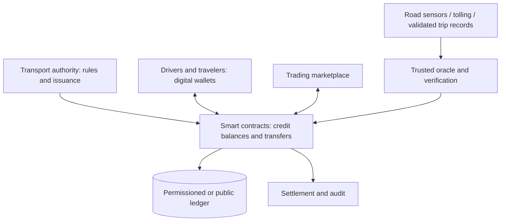

# Web3 for Sustainable Development
## Peer-to-Peer Energy Trading and Tradable Mobility Credits

**Frank Chuang**

### Learning objectives

After this lesson, students should be able to:

1. Explain how peer-to-peer (P2P) electricity markets and tradable mobility credit (TMC) schemes work.
2. Distinguish **physical infrastructure flows** from **commercial transactions and digital records**.
3. Calculate basic electricity losses and distinguish power (W) from energy (kWh).
4. Identify the **benefits and drawbacks** of each approach, including distributional and regulatory issues.
5. Evaluate when blockchains, smart contracts, and oracles add value—and when conventional databases suffice.
6. Distinguish theoretical proposals, prototypes, field trials, and operational public policies.

---

# Part I — Peer-to-Peer Energy Trading

## 1. What is P2P energy trading?

Traditional electricity markets typically involve large power generators, electricity utilities (companies responsible for electricity supply, networks, or retail services), and end consumers. The expansion of rooftop photovoltaics (PV), home batteries, electric vehicles, and smart meters enables some consumers to become **prosumers**: people or organizations that both produce and consume electricity.

**Peer-to-peer (P2P) energy trading** allows prosumers and consumers to agree on the sale and purchase of electricity quantities (or associated contractual rights) for specified periods, usually using a digital platform. Trading can be coordinated by a central operator, a consortium, or a blockchain-based system. **Blockchain is optional, not inherent to P2P trading.** [1–3]

| Term | Meaning |
|---|---|
| **Power grid / Electricity grid** | The interconnected infrastructure that generates, transmits, distributes, and supplies electricity. |
| **Transmission grid** | High-voltage network carrying bulk electricity over longer distances. |
| **Distribution grid** | Local network supplying homes, offices, and businesses. |
| **Smart grid** | Grid incorporating digital sensing, communication, monitoring, and control. |
| **Microgrid** | Locally managed electrical network that may, if equipped, operate independently from the main grid. |
| **Prosumer** | A participant that both produces and consumes electricity. |
| **Distributed energy resources (DERs)** | Solar PV, batteries, flexible demand (e.g., EV charging and smart appliances), electric vehicles, etc. |
| **Smart meter** | Meter measuring electricity imports and exports over defined intervals. |
| **Settlement** | Calculation of contractual payments using validated measurements and market rules. |

## 2. Physical electricity flow is not the same as a P2P transaction

**The key distinction:** If House B buys 10 kWh from House A, this does **not** mean that 10 kWh of identifiable electricity follows a dedicated path from A to B. On a shared grid, power flows according to network physics, including voltages, impedances, generation, and demand. The platform coordinates contracts, metering, billing, and financial settlement.

- **Physical flow:** actual electricity movement in the grid.
- **Commercial flow:** agreement about quantities, prices, time intervals, and counterparties.
- **Information flow:** meter readings, transaction confirmations, and verification data.
- **Financial flow:** payments, network charges, taxes, and balancing costs.

A private wire or specially configured microgrid can support more direct delivery, but this should not be confused with ordinary grid-connected P2P transactions.

## 3. P2P energy trading: Sequence diagram

### Illustrative economic example

Suppose A exports 10 kWh during an hour while B consumes 10 kWh in the same hour:

- A's alternative export compensation: **NT$2/kWh**.
- B's alternative retail purchase price: **NT$5/kWh**.
- Negotiated P2P price: **NT$3.5/kWh**.

| Outcome for 10 kWh | Without P2P | With P2P (illustrative) | Difference |
|---|---:|---:|---:|
| Seller A revenue | NT$20 | NT$35 | **+NT$15** |
| Buyer B electricity cost | NT$50 | NT$35 | **−NT$15** |

**Important:** This is a hypothetical, frictionless illustration—not an actual Taiwanese tariff or a guaranteed arbitrage opportunity. Network fees, taxes, platform fees, balancing charges, and market rules may reduce or eliminate the apparent savings.

## 4. Electricity units and transmission losses

### Power versus energy

| Quantity | Symbol and unit | Interpretation |
|---|---|---|
| **Power** | W (watt), kW (kilowatt) | Rate of energy transfer or consumption. |
| **Energy** | Wh (watt-hour), kWh (kilowatt-hour) | Total electricity produced or consumed over time. |

For constant power:

$$
E\;(\mathrm{kWh})=P\;(\mathrm{kW})\times t\;(\mathrm{hours})
$$

**Pronunciation:** “5 kWh of electricity” is read **“five kilowatt-hours of electricity.”** The abbreviation kWh is normally spoken as *kilowatt-hours*, not as the letters K–W–H. One kWh is one “unit” of electricity in many billing contexts (one **度電** in Taiwan).

### Why do transmission and distribution losses occur?

For a resistive conductor:

$$
\boxed{P_{\mathrm{loss}}=I^2R}
$$

- $P_{\mathrm{loss}}$: power dissipated as heat, measured in **watts (W)**.
- $I$: electric current, measured in **amperes (A)**.
- $R$: electrical resistance, measured in **ohms (Ω)**.

If $I=5\mathrm{A}$ and $R=2\Omega$, then:

$$
P_{\mathrm{loss}}=5^2\times2=50\mathrm{W}
$$

If this loss remains constant for ten hours:

$$
E_{\mathrm{loss}}=\frac{50\times10}{1000}=0.5\mathrm{kWh}
$$

**Nuance:** Longer wires often have greater resistance, but actual losses depend on voltage, current, network topology, operating conditions, and the distribution of generation and load. High-voltage transmission reduces current for a given transmitted power and therefore reduces resistive losses.

### “I purchased 10 kWh. Who covers the electricity lost in transit?”

A commercial contract must specify **where** and **how** the quantity is measured and settled. In a simplified dedicated-line example, injecting 10 kWh and losing 1 kWh leaves 9 kWh delivered. In a shared-grid P2P market, however, it is generally not meaningful to trace the buyer's exact 10 kWh from a particular seller. Grid operators and market rules account for losses and balancing; charges or loss factors may be allocated among market participants.

Buying from a nearby neighbor **may** reduce upstream network loading and losses when local generation and consumption coincide. But geographic proximity alone does not prove that losses fall; electrical network location and timing matter more than the address on a trade agreement.

## 5. What could blockchain contribute?

Potential blockchain functions include shared audit trails, programmable trade execution, automatic settlement, and multiparty coordination without relying entirely on one participant's private database. Smart contracts **cannot** directly measure physical electricity; they depend on reliable **oracles**, smart meters, and off-chain grid operators.

### Benefits of P2P energy trading

1. **Potentially better prices:** Prosumers may earn more for surplus generation and buyers may pay less, depending on tariffs and fees.
2. **Renewable energy participation:** Local trading can strengthen incentives to install solar PV, storage, and flexible loads.
3. **Consumer choice:** Participants may express preferences for locally generated or renewable electricity, subject to credible accounting.
4. **Local economic value:** Some energy revenues may circulate among community participants rather than solely through conventional retailers.
5. **Possible grid benefits:** Coordinated local generation and demand may reduce some network flows, peak demand, or losses—if market incentives align with actual grid conditions.
6. **Digital innovation:** Smart meters, automated settlement, and verifiable records can support new energy services.

### Drawbacks and challenges of P2P energy trading

1. **Regulatory barriers:** Retail licensing, utility responsibilities, consumer protection, and grid-access rules vary by jurisdiction.
2. **Network and balancing costs:** The grid still supplies reliability and backup; bypassing or underpaying these costs may shift burdens to nonparticipants.
3. **Intermittency:** Solar generation may not coincide with buyer demand, requiring storage, flexible consumption, or balancing supply.
4. **Equity concerns:** Households without suitable roofs, capital, or smart devices may be excluded from the benefits.
5. **Data privacy and cybersecurity:** Fine-grained electricity data can reveal occupancy and behavior.
6. **Operational complexity:** Meter verification, forecasting, settlement disputes, and interoperability create overhead.
7. **Blockchain-specific costs:** Smart-contract bugs, oracle manipulation, transaction costs, governance disputes, and limited throughput may outweigh decentralization benefits.
8. **Environmental claims need evidence:** A recorded “local” or “green” transaction does not automatically imply lower physical losses or emissions.

---

# Part II — Tradable Mobility Credits

## 1. What are tradable mobility credits?

Traffic congestion, local air pollution, greenhouse gas emissions, and road scarcity motivate policies that manage travel demand. Conventional tools include fuel taxes, parking fees, congestion charges, and vehicle restrictions.

A **Tradable Mobility Credit (TMC)** or **Tradable Mobility Permit** system allocates a limited quantity of mobility-related rights to eligible participants. Certain travel activities require credits; participants who need more can buy them from participants who use less. The precise meaning of a credit—road entry, distance, time, emissions, or zone access—depends on the scheme's rules. [4–7]

## 2. A simple cap-and-trade example

Suppose a city gives each eligible resident **100 credits per month**. A hypothetical road-use policy requires credits for selected trips:

- Driver A needs **120 credits** and must buy **20** additional credits.
- Driver B needs **60 credits** and can sell up to **40** unused credits.
- A buys **20 credits** from B through a regulated marketplace.

**This is a teaching illustration, not an actual city policy.** Credits are not inherently cryptocurrencies, and one credit does not necessarily equal one kilometer. A city could charge different amounts by location, time, vehicle type, congestion level, or environmental impact.

## 3. Why would cities use a tradable credit scheme?

A TMC system borrows from **cap-and-trade** economics: set an aggregate allowance (the **cap**) and allow trading (the **market**) so that participants with higher willingness to pay can acquire more rights, while those who reduce travel can sell unused rights.

**Market design choices matter:** initial allocation, eligible population, cap size, pricing rules, market power safeguards, expiration, credit banking, exemptions, enforcement, and treatment of visitors and low-income travelers.

## 4. Blockchain-based mobility-credit architecture

Possible smart-contract operations include **issue**, **transfer**, **spend**, **expire**, and **retire** credits. A regulated scheme would still require identity management, privacy protections, dispute resolution, enforcement, and public accountability.

A blockchain may make cross-organization records auditable, but it does **not** guarantee that trip-detection data are accurate. Publishing precise travel histories on a public ledger could be seriously privacy-invasive; privacy-preserving architecture and selective disclosure are essential.

### Benefits of tradable mobility credits

1. **Traffic-demand management:** A binding cap can limit aggregate credited road use, depending on enforcement and how credits map to travel.
2. **Flexible behavior:** Travelers choose whether to spend credits, change routes or travel times, use public transport, or trade unused rights.
3. **Potentially transparent incentives:** Credit prices communicate scarcity and can encourage off-peak or lower-impact travel.
4. **Possibility of redistribution:** Equal or targeted initial allocations can benefit some lower-driving households through credit sales.
5. **Policy customization:** Credits can vary by congestion zone, time of day, vehicle category, or emissions impact.
6. **Data-driven evaluation:** Digital records can help assess policy outcomes, subject to robust privacy safeguards.
7. **Potential blockchain value:** Shared auditability and programmable transfers may help when multiple agencies or service providers must coordinate.

### Drawbacks and challenges of tradable mobility credits

1. **Fairness and access:** People with disabilities, caregiving obligations, long commutes, or weak transit alternatives may face disproportionate costs.
2. **Complexity and public acceptance:** A credit market may be harder to understand than a simple toll and can be politically controversial.
3. **Volatile or manipulated prices:** Market concentration, hoarding, speculation, and thin trading can distort credit prices.
4. **Privacy and surveillance:** Tracking trips, road entry, or location raises significant civil-liberty and cybersecurity concerns.
5. **Implementation costs:** Enforcement equipment, identity verification, account management, and dispute resolution are expensive.
6. **Uncertain environmental effects:** Reduced traffic in one area can shift congestion elsewhere; emission outcomes depend on actual travel behavior.
7. **Unequal digital access:** Users without smartphones, banking access, or technical literacy may be disadvantaged.
8. **Blockchain-specific risks:** Irreversible errors, wallet loss, smart-contract vulnerabilities, governance complexity, and unnecessary public exposure of transaction metadata.

## 5. Real-world evidence versus proposed systems

| Example | What it illustrates | Important qualification |
|---|---|---|
| **Amsterdam UMIX (metaCCAZE)** | A real-world urban mobility incentive and exchange pilot. [4] | A field pilot is not proof of citywide permanent adoption or blockchain use. |
| **Tradable Mobility Permit with Bitcoin and Ethereum (Bagloee et al., 2019)** | A research proposal/application exploring blockchain for tradable mobility permits. [5] | Academic design is not evidence of a deployed citywide system. |
| **MobilityCoin System (2022)** | A detailed mobility-credit framework with diagrams of traveler decisions and trading. [6] | A mobility coin is not automatically an on-chain cryptocurrency. |
| **ScienceDirect article supplied by the instructor (2026)** | Additional research context. [7] | Bibliographic details and findings should be checked against the full article. |

**State of practice:** Real congestion charges operate in several cities, and mobility-credit pilots and research experiments exist. However, those facts do not establish that a full-scale **blockchain-based, tradable mobility-credit** scheme has become standard municipal infrastructure.

---

# Part III — Classroom Rxercise: Design a Token Market

**Teams:** Choose either an apartment-building solar energy market or a city mobility-credit market. In 20–30 minutes, propose:

1. **Resource and unit:** What exactly does one token or credit represent?
2. **Issuance:** Who creates it, and under what rules?
3. **Exchange:** Who can trade it, and how is the price determined?
4. **Verification:** Which trusted measurements or oracles confirm real-world events?
5. **Settlement:** What happens when supply, demand, or measurements differ from expectations?
6. **Governance:** Who can change the rules, resolve disputes, or revoke fraudulent credits?
7. **Evaluation:** Specify one environmental, one economic, and one equity metric.
8. **Technology choice:** Explain whether blockchain is justified.

---

# References

## P2P energy trading

**[1]** International Renewable Energy Agency (IRENA). (2020). *Innovation landscape Brief: Peer-to-Peer Electricity Trading*.
https://www.irena.org/-/media/Files/IRENA/Agency/Publication/2020/Jul/IRENA_Peer-to-peer_electricity_trading_2020.pdf

**[2]** Enjoyelec. *Understanding Peer-to-Peer Energy Trading*.
https://www.enjoyelec.net/understanding-peer-to-peer-energy-trading/

**[3]** *EnergyAuction: IoT-Blockchain Architecture for Local Peer-to-Peer Energy Trading in a Microgrid*. (2023). *Sustainability, 15*(17), 13203.
https://www.mdpi.com/2071-1050/15/17/13203

**Video A:** https://www.youtube.com/watch?v=XuTbY777k48
**Video B:** https://www.youtube.com/watch?v=ISoTNe-0yX8

## Tradable mobility credits

**[4]** metaCCAZE. *Amsterdam Tests Fair Mobility with UMIX Use Case*.
https://www.metaccaze-project.eu/amsterdam-tests-fair-mobility-with-umix-use-case/

**[5]** Bagloee, S. A., et al. (2019). *Tradable mobility permit with Bitcoin and Ethereum – A blockchain application in transportation*. *Internet of Things, 8*, 100103.
https://www.sciencedirect.com/science/article/abs/pii/S2542660519302240

**[6]** *The MobilityCoin System*. (2022). *Frontiers in Future Transportation*.
https://www.frontiersin.org/journals/future-transportation/articles/10.3389/ffutr.2022.914496/full
