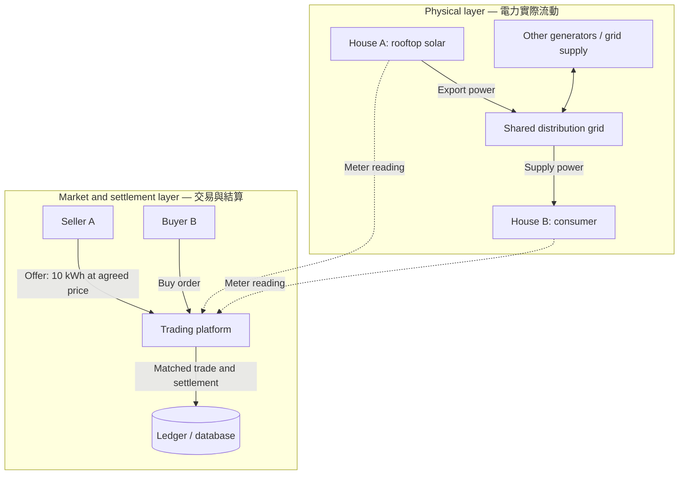
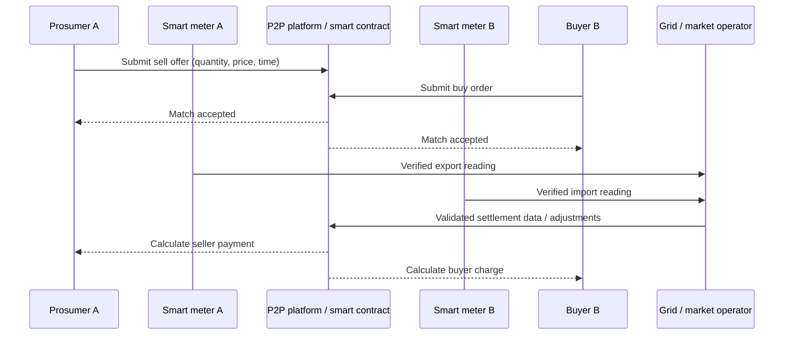
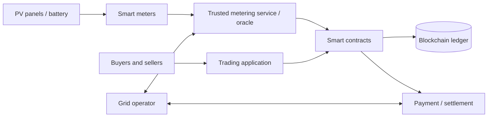
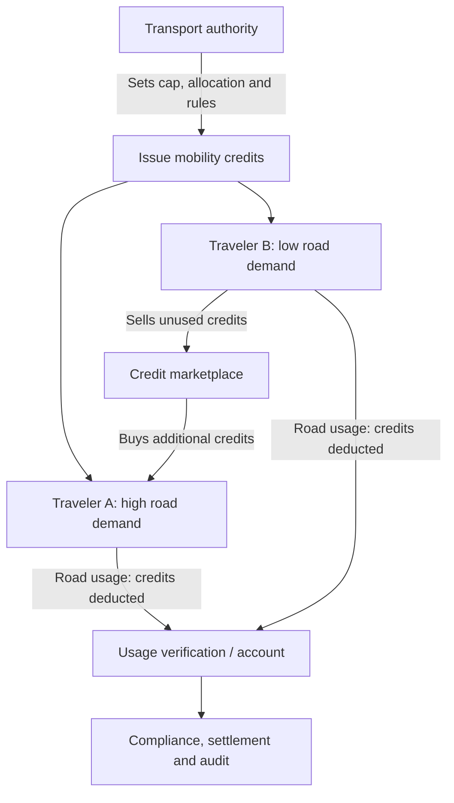
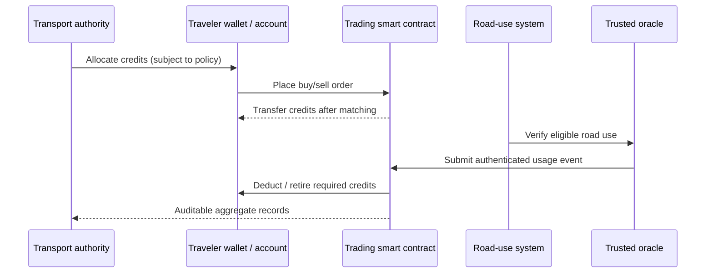
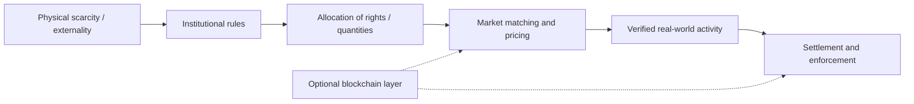

# Web3 for Sustainable Development: P2P Energy Trading and Tradable Mobility Credits

> Course handout | 資管系大學部 | Updated: 2026-11-16  
> Focus: energy and mobility market design, physical infrastructure, token economics, and blockchain architecture.

## Learning objectives

完成本講義後，學生應能：

1. 解釋 **Peer-to-Peer (P2P) Energy Trading** 的參與者、電網運作與結算方式。
2. 區分 **physical electricity flow** 與 **contractual/financial trading flow**。
3. 計算基本電力損耗，辨別 **power (W)** 與 **energy (kWh)**。
4. 說明 **Tradable Mobility Credits (TMC)** 如何以總量限制與市場交易管理交通需求。
5. 評估 Blockchain、Smart Contracts、Oracles 在兩種制度中的必要性、優點與限制。
6. 區分概念設計、研究原型、實地試辦與正式制度。

---

# Part I. Peer-to-Peer Energy Trading（點對點電力交易）

## 1. Background: from consumers to prosumers

傳統電力系統以大型發電廠供電，用戶主要扮演 **consumer（消費者）**。隨著屋頂太陽能、家用儲能及智慧電表普及，一部分住戶同時能發電與用電，稱為 **prosumer（產消者；producer + consumer）**。

**Peer-to-Peer Energy Trading** 是讓產消者、用戶或其他市場參與者，透過數位平台交易特定時段的電量與相關權益。交易可以由中心化平台或分散式帳本支援；**Blockchain 不是 P2P 電力交易的必要條件**。[1][2]

### Key terms

| Term | 中文 | 說明 |
|---|---|---|
| Power grid / Electricity grid | 電網 | 發電、輸電、配電及用電所構成的系統 |
| Transmission grid | 輸電網 | 通常以較高電壓輸送大量電力 |
| Distribution grid | 配電網 | 將電力配送至社區及終端用戶 |
| Smart grid | 智慧電網 | 整合感測、通訊、控制與數據分析的電網 |
| Microgrid | 微電網 | 可管理局部電源與負載，部分設計可孤島運轉 |
| Prosumer | 產消者 | 同時生產與消費電力的參與者 |
| Distributed Energy Resources (DERs) | 分散式能源資源 | 如太陽能、電池、可控負載與電動車 |
| Smart meter | 智慧電表 | 按時段量測進出電量 |
| Settlement | 結算 | 根據計量與合約計算應收應付 |

## 2. Two different flows: electricity versus trading records

**關鍵觀念：** A 與 B 簽訂 10 kWh 的交易，不代表有一組特定電子沿著 A → B 的專屬路線移動。共同電網中的電力分配由電壓、阻抗、即時發電與負載等物理條件決定；交易平台管理的是**契約、計量、權益與結算**。

- **Physical flow**：實際電力依電網物理規律流動。
- **Commercial flow**：買賣雙方對特定時段電量及價格達成約定。
- **Information flow**：智慧電表、通訊設備與平台回報經驗證的讀值。
- **Financial flow**：買方付款、賣方收款、支付電網與平台相關費用。

即使兩戶很近，也不能僅憑「向鄰居買電」宣稱實體電力一定從該鄰居流入家中。

## 3. A simplified transaction example

假設某一小時內：

- A 的屋頂太陽能發出 **15 kWh**，自用 **5 kWh**，可向電網輸出 **10 kWh**。
- B 在相同時段需要 **10 kWh**。
- A 的其他售電選項為 **NT$2/kWh**；B 的替代購電價格為 **NT$5/kWh**。
- 雙方在 P2P 平台以 **NT$3.5/kWh** 成交。

| Item | Without P2P | With P2P (hypothetical) |
|---|---:|---:|
| A 的售電收入（10 kWh） | NT$20 | NT$35 |
| B 的購電支出（10 kWh） | NT$50 | NT$35 |
| A 的差額 | — | +NT$15 |
| B 的差額 | — | −NT$15 |

> **Teaching assumption:** 以上為簡化的市場價格示例，**未計入**電網使用費、損耗補償、稅費、平台費、平衡電力成本及當地法規；不是臺灣實際可直接套用的電價或交易制度。

### Transaction lifecycle

智慧合約只能依收到的資料執行規則，**不能自行驗證真實世界的電力流量**。因此必須設計可信的計量、資料驗證與爭議處理機制。

## 4. Power versus energy: W, kW and kWh

- **Power（功率）**：能量轉換或傳遞的速率，單位 **W（watt）** 或 **kW（kilowatt）**。
- **Energy（電能）**：一段時間內累積的能量，單位 **Wh** 或 **kWh（kilowatt-hour）**。
- **1 kWh = 1 度電**。
- **5 kWh of electricity** 念作 **five kilowatt-hours of electricity**，即「五度電」。通常不把 kWh 逐字母念成 K-W-H。

在功率固定的情況下：

\[
E\,(\mathrm{kWh}) = P\,(\mathrm{kW}) \times t\,(\mathrm{h})
\]

例如 1 kW 電器連續運作 5 小時，消耗 **5 kWh**。

## 5. Why does electricity transmission incur losses?

在簡化的電阻線路模型中，**Joule heating（焦耳熱）**造成的功率損耗為：

\[
P_{\mathrm{loss}}=I^2R
\]

其中：

- \(P_{\mathrm{loss}}\)：**power loss（功率損耗）**，單位 **W**。
- \(I\)：**electric current（電流）**，單位 **A（ampere）**。
- \(R\)：**resistance（電阻）**，單位 **Ω（ohm）**。注意拼字是 **resistance**，不是 *resistence*。

若 \(I=5\,\mathrm{A}\)、\(R=2\,\Omega\)，則：

\[
P_{\mathrm{loss}}=5^2\times2=50\,\mathrm{W}
\]

若持續 10 小時，能量損失為：

\[
E_{\mathrm{loss}}=50\,\mathrm{W}\times10\,\mathrm{h}=500\,\mathrm{Wh}=0.5\,\mathrm{kWh}
\]

**注意：** 這是簡化電阻模型。真實交流電網還涉及三相系統、功率因數、變壓器及其他損耗；不能直接把單一 \(I^2R\) 公式當作整個電網的總損耗。

### If a buyer purchases 10 kWh, who pays for losses?

必須區分：

1. **Injection-based contract**：約定賣方在特定計量點注入 10 kWh。
2. **Delivery-based contract**：約定買方在特定交付點取得 10 kWh 的結算保障。
3. **Network settlement**：電網營運商或其他市場主體依規則處理損耗、平衡與網路費用。

**已成交 10 kWh 不代表物理損耗消失。** 損耗如何計價及由誰承擔，取決於契約與市場制度。

### Does buying electricity from a neighbor reduce losses?

**不一定。** 若在地發電與負載在時間、電網位置上相互匹配，可能減少上游潮流與部分損耗；但效果取決於**實際電網拓樸、電壓、潮流及負載**，不是交易雙方的直線地理距離，更不是是否使用 Blockchain。

## 6. Blockchain architecture and design choices

| Component | Function | Important caveat |
|---|---|---|
| Smart meter | 量測分時電量 | 硬體遭竄改或校正錯誤會造成錯誤資料 |
| Oracle / data gateway | 將驗證後的電表資料送入合約 | **Oracle problem**：上鏈不保證資料原本正確 |
| Smart contract | 撮合、託管、計價與結算 | 必須處理異常、取消、爭議與升級 |
| Blockchain | 多方共享、可稽核的交易紀錄 | 有交易成本、延遲、隱私及治理問題 |
| Grid operator | 維持電網安全與平衡 | 不能被智能合約取代 |

**When is blockchain useful?** 當多個市場參與者不願將紀錄完全交由單一平台控制、需要跨機構共享稽核紀錄、或可程式化權益與清算時，區塊鏈可能有價值。若已有可信且有效率的中心化營運商，傳統資料庫可能更簡單、便宜且容易保護隱私。

## 7. Benefits and limitations

**Potential benefits**：提高產消者參與度、增加再生能源交易選擇、創造社區經濟誘因、改善資訊透明度；在適當條件下可能改善在地能源利用。[1][2]

**Limitations**：法規及電網接入、輸配電費用、公平性、資料隱私、電表可信度、供需時序匹配、電網擁塞，以及 Blockchain 的可擴展性。

> **Critical reading:** 供應商文章常強調「在地交易必然減少輸電損耗」。教學時應把這類說法視為**待驗證的條件式主張**，而非普遍物理定律。

## 8. Cases and readings

- **IRENA (2020)**：完整入門圖解、商業模式、部署條件與案例。[1]
- **Enjoyelec (2025)**：有圖的簡介網站，適合課前快速閱讀；需批判性閱讀其效益宣稱。[2]
- **Brooklyn Microgrid**：社區能源交易的代表性示範案例；應區分試驗/示範與現行正式商業營運。[1]
- **EnergyAuction (2023)**：IoT、電表、Blockchain 與交易平台的系統架構。[3]

### Suggested visual reading

1. IRENA 的 **Distributed Energy Resources** 與 P2P business model 圖：認識參與者與交易市場。
2. Enjoyelec 的 **What is P2P Energy Trading?** 圖：辨認圖中交易箭頭與實體電網。
3. EnergyAuction 論文架構圖：找出 Smart Meter、Oracle / gateway、Blockchain 的信任邊界。

---

# Part II. Tradable Mobility Credits（可交易交通額度）

## 9. The congestion problem and policy instruments

道路在尖峰時段是稀缺資源。駕駛者決策時通常不會完全承擔其造成的額外擁塞、空污及碳排成本，因此可能出現 **negative externalities（負外部性）**。

常見政策工具包括：

- **Congestion pricing（擁擠收費）**：依道路、區域或時段收費。
- **Tradable Mobility Credits (TMC)** / **Tradable Mobility Permits (TMP)**：先設定可使用額度總量或配置規則，再允許符合資格的參與者交易額度。
- **Mobility as a Service (MaaS)**：整合運輸服務與支付，**不等於** TMC。

**核心差異：** TMC 的特色是**可交易的額度／許可權**，不是單純用 Token 支付過路費。

## 10. How a tradable credit system works

### Hypothetical example (not an actual city's rules)

政府每月分配每人 **100 credits**：

- A 需要 120 credits，必須再買 20。
- B 只需要 60 credits，可以出售最多 40（假設無其他保留限制）。
- 若每 credit 市價為 NT$3，A 買 20 credits 需付 **NT$60**。
- A 的額度增加 20，B 的額度減少 20；**交易不會憑空增加系統發行總量**。

在這個例子中，B 因少用道路而取得出售額度的機會；A 則為額外道路使用支付市場價格。

### A credit is not automatically a kilometre

額度的定義必須由政策決定，可能是：

- 每次進入擁塞區扣若干 credits。
- 依時段、路段、距離、車型或擁塞程度扣不同 credits。
- 對公共運輸、共乘或無障礙需求提供不同規則。

**不要假設 1 credit = 1 km，或每人一定分配相同額度。** 這些都是制度設計選擇。

## 11. Token economics and market design

### Cap-and-trade intuition

主管機關透過總量、配額或核發規則限制特定活動，允許使用者交易未用額度。市場價格反映稀缺程度，但**是否有效減少壅塞取決於額度需求與真實道路使用的連結、總量設定、執法及替代運具可用性**。

| Design variable | Key question |
|---|---|
| Cap / issuance | 每月發行多少？是否逐年減少？ |
| Allocation | 平均分配、依需求、依收入或依交通可及性？ |
| Redemption | 哪些道路行為需要扣除？何時扣除？ |
| Pricing | 自由市場、拍賣、價格上下限或官方回購？ |
| Transferability | 能否自由交易？是否設交易上限？ |
| Expiration | 額度是否可跨期累積？ |
| Enforcement | 如何驗證道路使用並防止重複扣款？ |
| Equity | 對偏鄉、低收入、身障及必要通勤者是否公平？ |

## 12. Blockchain-based TMC architecture

**Potential on-chain functions**：額度發行、轉讓、餘額、交易規則、扣除/銷毀與稽核。

**Essential off-chain functions**：道路感測、車輛與使用者資格驗證、個資保護、違規處理、政策申訴及實際交通管理。

### Privacy and governance

道路使用資料可能揭露住家、工作地點、醫療就診或日常行程。因此，**不宜將精確 GPS 軌跡或可識別的逐次通行資料直接寫入公開區塊鏈**。可考慮將原始資料保留於受管制系統，只在鏈上記錄必要的承諾、餘額或經驗證的交易摘要；若採用 ZKP 等隱私技術，仍須評估成本、可驗證性及撤銷機制。

**Blockchain 不會自動保證公平、隱私或防止假資料。** 制度設計與可信資料來源通常比 Token 格式更重要。

## 13. Real-world maturity: what has actually been tested?

### Amsterdam: UMIX (Urban Mobility Incentive Exchange)

metaCCAZE 的阿姆斯特丹 UMIX 是**真實場域試辦**：參與者依實際移動需求與可用選項取得虛擬額度，藉此探索更公平且永續的交通行為與資源配置。[4]

**Teaching distinction:** UMIX 是 mobility-credit 類型的實地試辦，但官方介紹**不足以證明其使用 Blockchain**；不可直接稱作已正式部署的 Blockchain-based TMC 城市系統。

### Research design: tradable mobility permit with Ethereum

Bagloee 等人的 2019 年論文提出並以數值方式測試 **Tradable Mobility Permit (TMP)**，討論 Ethereum / Smart Contracts 的潛在部署方式，包括道路擁擠管理與動態收費。[5]

**Teaching distinction:** 這是具體的學術設計與數值測試，**不是已確認正式上路的區塊鏈道路許可交易制度**。

### MobilityCoins research

MobilityCoins 研究探討如何透過額度與交通選擇影響行為；**名稱中有 Coin 不代表必然使用加密貨幣或 Blockchain**。[6]

## 14. Comparing the two Web3 applications

| Dimension | P2P Energy Trading | Tradable Mobility Credits |
|---|---|---|
| Scarce resource | 特定時段可供交易的電能／供需彈性 | 道路容量／可用通行額度 |
| Main participants | Prosumers, buyers, retailers, grid operators | Travelers, regulators, marketplace operators |
| Unit | kWh（電能） | Credit / permit（政策定義） |
| Physical infrastructure | Electricity grid | Road / transport network |
| Verification | Smart meters, validated settlement data | Road-use sensors, eligibility and usage records |
| Trading purpose | 協調分散式供需與價格 | 分配稀缺道路使用權、調整交通需求 |
| Smart contract | 撮合、計價、清算 | 發行、轉讓、扣除、稽核 |
| Central governance | 電網安全與市場規則不可省略 | 主管機關設定額度與執法規則 |
| Sustainability potential | 促進分散式再生能源整合 | 抑制壅塞及其外部成本 |
| Major risk | 計量、電網約束與結算公平性 | 交通公平性、隱私與政策可接受度 |

### A common conceptual framework

**Core lesson:** Web3 是可選的**協調與紀錄技術層**；真正決定永續成果的是實體系統、制度規則、參與者誘因與可信驗證。

---

# Part III. Class activities and discussion

## 15. Discussion questions

1. A 向鄰居 B 買 10 kWh，是否代表 A 的電器只使用 B 的太陽能電力？為什麼？
2. 如果 A 賣出 10 kWh，但因損耗或計量差異，交付點讀值不同，誰應承擔差額？
3. 在什麼條件下，「買附近的電」才可能降低電網損耗？
4. P2P energy trading 是否一定需要 Blockchain？請提出一個中心化方案作比較。
5. Mobility credits 若人人平均分配，對無公共運輸替代選項的通勤者公平嗎？
6. TMC 的額度總量若設得過高或過低，會發生什麼問題？
7. 使用公開區塊鏈記錄道路通行資訊，會造成哪些隱私風險？
8. 比較兩個案例的 **oracle problem**：如何確定鏈上的資料反映真實世界？

## 16. Short classroom exercise: design a token market

分組設計一個智慧城市方案（能源或交通二選一），以一頁簡報回答：

- **Problem**：要解決哪種資源稀缺或外部性？
- **Token / unit**：交易標的是什麼？如何發行與扣除？
- **Market rules**：誰可交易？如何定價？
- **Verification**：哪些資料需要可信的 off-chain oracle？
- **Governance**：誰可調整規則、停用帳戶、處理爭議？
- **Blockchain necessity**：為什麼不用傳統資料庫？
- **Sustainability KPI**：如何實證改善效果，而非只計算交易筆數？

**Suggested evaluation criteria:** problem definition 20%; economic mechanism 25%; technical feasibility 20%; governance/privacy 20%; sustainability evaluation 15%.

---

# References and visual resources

## Peer-to-Peer Energy Trading

[1] IRENA. (2020). *Innovation landscape brief: Peer-to-peer electricity trading*. International Renewable Energy Agency.  
https://www.irena.org/-/media/Files/IRENA/Agency/Publication/2020/Jul/IRENA_Peer-to-peer_electricity_trading_2020.pdf  
**Suggested use:** official illustrated overview, DERs, P2P business model, deployment requirements.

[2] Enjoyelec. (2025, February 8). *Understanding Peer-to-Peer Energy Trading*.  
https://www.enjoyelec.net/understanding-peer-to-peer-energy-trading/  
**Suggested use:** accessible illustrated introduction; evaluate commercial claims critically.

[3] *EnergyAuction: IoT-Blockchain Architecture for Local Peer-to-Peer Energy Trading in a Microgrid*. (2023). *Sustainability*, 15(17), 13203.  
https://www.mdpi.com/2071-1050/15/17/13203  
**Suggested use:** system architecture and IoT / Blockchain integration.

**Videos supplied for the course (titles/content should be checked before classroom use):**

- https://www.youtube.com/watch?v=XuTbY777k48
- https://www.youtube.com/watch?v=ISoTNe-0yX8

## Tradable Mobility Credits

[4] metaCCAZE. *Amsterdam Tests Fair Mobility with UMIX Use Case*.  
https://www.metaccaze-project.eu/amsterdam-tests-fair-mobility-with-umix-use-case/  
**Suggested use:** real-world pilot; site links to an explanatory video.

[5] Bagloee et al. (2019). *Tradable mobility permit with Bitcoin and Ethereum – A Blockchain application in transportation*. *Internet of Things*, 8, 100103. DOI: 10.1016/j.iot.2019.100103.  
https://www.sciencedirect.com/science/article/abs/pii/S2542660519302240  
**Suggested use:** blockchain/TMP concept, model and smart-contract discussion.

[6] *The MobilityCoin System*. (2022). *Frontiers in Future Transportation*.  
https://www.frontiersin.org/journals/future-transportation/articles/10.3389/ffutr.2022.914496/full  
**Suggested use:** conceptual diagrams and mobility incentive design; not necessarily blockchain-based.

[7] **User-provided 2026 ScienceDirect article (bibliographic details not independently verified)**.  
https://www.sciencedirect.com/science/article/pii/S0965856426004763  
**Suggested use:** additional reading after confirming title, abstract and relevance.

## Notes on use and source quality

- Mermaid diagrams in this handout are **original teaching schematics**, not reproductions of published figures.
- Real-world policies, electricity tariffs, blockchain deployments and pilot status can change; verify official sources before presenting a case as currently operational.
- External images in source publications may have their own copyright or reuse conditions; cite the original publisher if reusing them in lecture slides.
